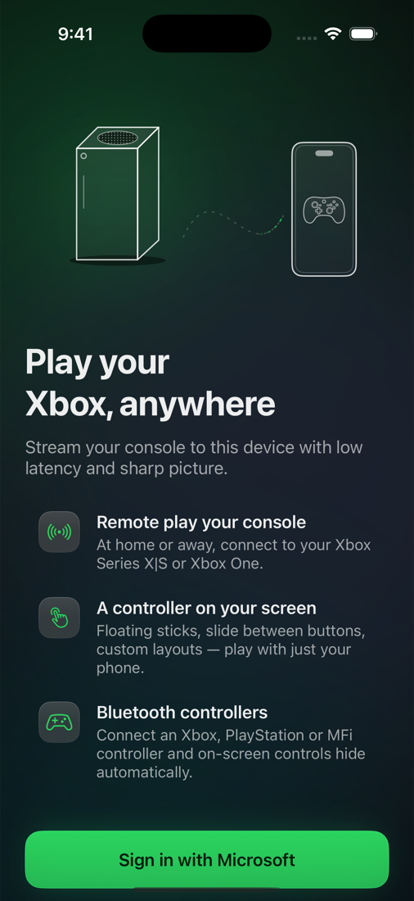
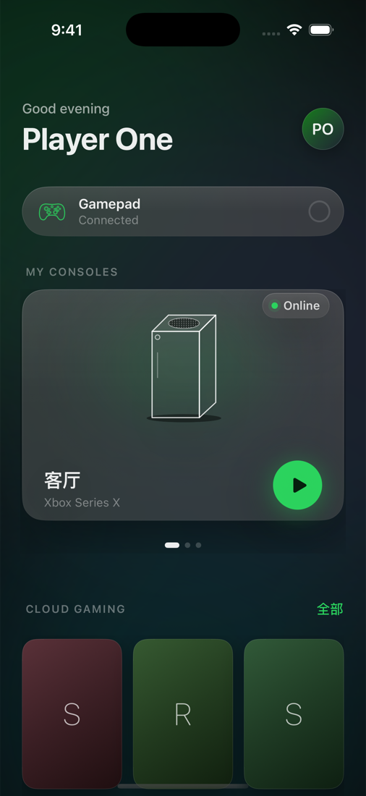
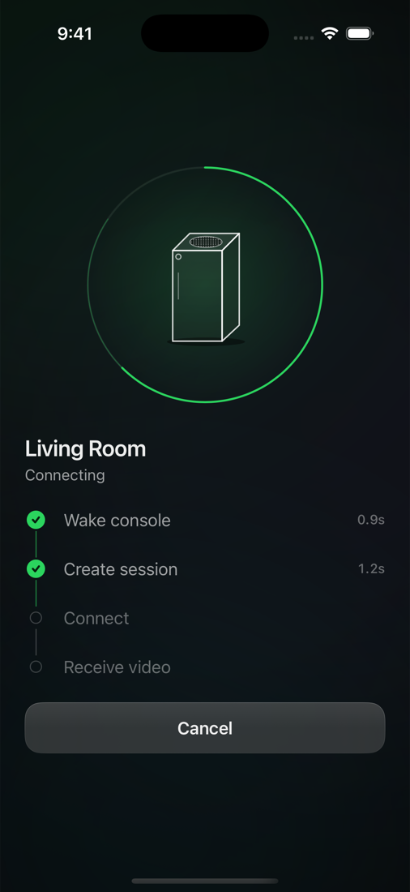
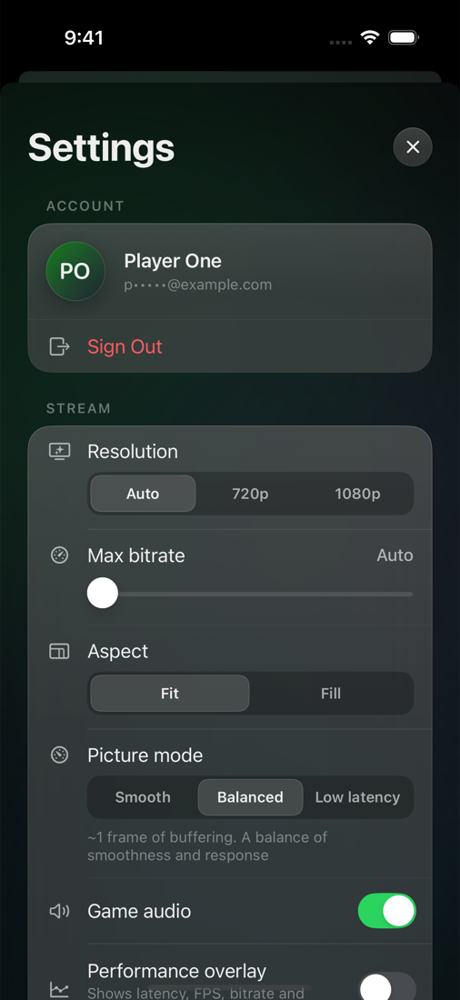

# Xbox Remote（iOS + macOS）

用手机或 Mac 远程串流玩你家里的 Xbox 主机。iPhone 上自带屏幕手柄（浮动摇杆、ABXY、十字键、LB/RB/LT/RT），只用手机就能玩；连上蓝牙手柄（Xbox / PlayStation / MFi）后屏幕按键自动隐藏。Mac 版支持键盘鼠标映射和蓝牙手柄。

串流协议是原生实现的（Microsoft 登录 → Xbox 令牌 → xHome 会话 → WebRTC），协议细节参考了开源项目 [xbox-xcloud-player](https://github.com/unknownskl/xbox-xcloud-player)、[xal-node](https://github.com/unknownskl/xal-node) 和 [Greenlight](https://github.com/unknownskl/greenlight)。

> 本项目与 Microsoft 无关。协议是逆向得来的，微软改动接口时可能需要更新。

## 在 Mac 上编译

需要：Xcode 15 或更新版本、Apple 开发者账号（你已经有了）。

```bash
brew install xcodegen      # 只需要装一次
cd ios-xbox-remote
xcodegen                   # 生成 XboxRemote.xcodeproj
open XboxRemote.xcodeproj
```

1. 第一次打开时 Xcode 会自动下载 WebRTC 依赖（stasel/WebRTC，约 100 MB），稍等片刻。
2. 选中项目 → 两个 target（`XboxRemote-iOS`、`XboxRemote-macOS`）→ **Signing & Capabilities** → Team 选你的开发者账号。
   如果提示 Bundle ID 已被占用，把 `project.yml` 里的 `com.example.xboxremote` 改成你自己的（例如 `com.你的名字.xboxremote`），再运行一次 `xcodegen`。
3. **iPhone**：选择 `XboxRemote-iOS` scheme 和你的手机，按 ⌘R。第一次需要在手机「设置 > 通用 > VPN 与设备管理」里信任开发者。
4. **Mac**：选择 `XboxRemote-macOS` scheme，目标选「My Mac」，按 ⌘R。
5. **单元测试**：`XboxRemote-iOS` scheme 下按 ⌘U（测试输入报文编码、签名、SDP、Teredo、键位映射）。

> 改了 `project.yml` 或新增文件后，需要重新运行 `xcodegen`。

## 主机设置

1. 主机：**设置 > 设备与连接 > 远程功能**，勾选「启用远程功能」。
2. 主机：**设置 > 常规 > 电源选项**，电源模式选「睡眠」（这样关机后也能被远程唤醒）。
3. 主机和 App 登录同一个 Microsoft 账号。
4. 网络：主机尽量用网线；手机用 5GHz Wi-Fi。外出时家里上行带宽至少 10 Mbps。

## 使用

- 打开 App → 「使用 Microsoft 账号登录」→ 主页会列出你的主机 → 点绿色播放按钮。
- 调试版本（Debug）在欢迎页有「演示模式」，不用账号也能看全部界面和屏幕手柄。
- 串流时：左上角的小圆点（或三指下滑）打开快捷菜单，可以切换画质、调整屏幕按键透明度、编辑布局、截图、看性能数据、断开连接（按住确认）。

### 屏幕手柄（iPhone / iPad）

- 左摇杆是浮动的：左半屏下方任意位置按下就出现；双击按住 = L3。右摇杆双击按住 = R3。
- 手指可以在 ABXY 之间滑动连按，按在两个键中间会同时触发。
- 十字键支持八方向滑动。
- 4 秒不操作按键会自动变淡。
- 设置 > 屏幕按键 > 编辑布局：拖动移动、双指缩放、对齐吸附；可以保存多套布局（默认 / 赛车 / 射击 / 自定义）。

### Mac 键盘默认键位

| 功能 | 按键 |
| --- | --- |
| 左摇杆 | W A S D |
| 右摇杆 | 方向键 |
| A / B / X / Y | Space / Esc（或 Backspace）/ F / R |
| LB / RB | Q / E |
| LT / RT | Shift（或鼠标右键）/ 鼠标左键 |
| 十字键 | I J K L |
| 视图 / 菜单 / Xbox 键 | Tab / Enter / H |
| L3 / R3 | C / V |

设置 > 键位映射里可以改键（点一行再按键盘即可，冲突时自动互换）。

菜单栏快捷键：⌘R 刷新主机、⌘F 全屏、⌘I 性能浮层、⌃⌘M 快捷菜单、⌘W 断开连接、⌘, 设置。

## 代码结构

```
project.yml            XcodeGen 工程配置（iOS + macOS + 单元测试）
Shared/
  App/                 入口、全局状态、设置、数据模型
  Auth/                Microsoft / Xbox 登录（设备令牌签名、SISU、XSTS、串流令牌）
  Streaming/           串流 REST 接口、WebRTC 连接、数据通道协议、SDP / Teredo 工具
  Input/               手柄状态、输入报文编码、蓝牙手柄 / 键盘、震动
  DesignSystem/        颜色字体等设计令牌、玻璃材质、组件、自绘图形
  UI/                  各个页面
iOS/                   屏幕手柄、布局编辑器、iOS 平台代码
macOS/                 键位映射、菜单栏命令、Mac 平台代码
Tests/                 单元测试
```

## 自动检查（CI）

每次推送都会在 GitHub 的 macOS 机器上自动：生成工程 → 编译 iOS 版 → 编译 Mac 版 → 跑单元测试 → 在模拟器里用演示模式截图。
截图会提交到 [`docs/screenshots/`](docs/screenshots/)，可以直接在 GitHub 上看界面。

| 欢迎 | 主页 | 连接中 | 设置 |
| --- | --- | --- | --- |
|  |  |  |  |

（串流页和布局编辑器是横屏的，截图在 `docs/screenshots/ios-stream.png`、`ios-editor.png`。）

## 云游戏

需要 Game Pass Ultimate（或所在地区支持的免费云游戏）。主页「云游戏」一栏会列出最近玩过的游戏，点「全部」打开游戏库（可搜索）。

## 已知限制 / 后续计划

- 语音聊天未实现。
- 协议是逆向的，第一次真机连接如果失败，请把 Xcode 控制台的日志发给我，我来根据返回调整字段。

## 延迟优化

性能浮层（Mac 按 ⌘I，或在快捷菜单里打开）点一下会展开延迟详情：网络、缓冲、解码、画面模式各占多少毫秒，以及实际线路。

- 线路显示「局域网直连」才是最佳状态；显示「经公网 / 经中继」说明没有直连，延迟会高很多。
- 主机尽量插网线，这一条影响最大。
- 电脑 / 手机连 5GHz Wi-Fi。
- Mac 上关闭「隔空投送」（控制中心 › 隔空投送 › 关闭）可减少 Wi-Fi 周期性卡顿。
- 对反应要求高的游戏选「低延迟」画面模式。
